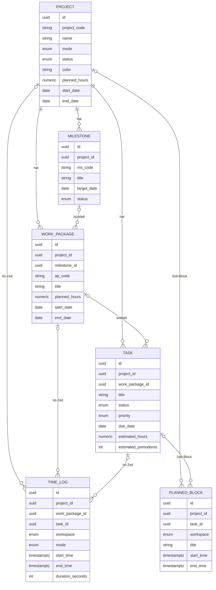
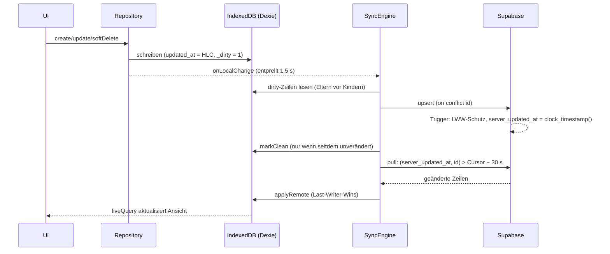

# Pomodoro-Planer v2 – Architektur & Umsetzungsplan

Stand: 15.10.2026 · Branch `claude/tender-gates-ufxzx9`

Dieses Dokument beschreibt, wie aus dem bestehenden Pomodoro-Planer (v1) eine plattformübergreifende
Lern- und Zeiterfassungs-App mit zwei Modi, professionellem Projekt-Tracking, Kalender, Excel-Schnittstelle
und Offline-First-Sync zwischen Laptop und Handy wird. Es ist bewusst als Entscheidungsgrundlage geschrieben:
Abschnitt 11 listet die Punkte, die du festlegen solltest, bevor die nächste Phase startet.

---

## 1. Bestandsaufnahme (v1)

| Bereich | Ist-Stand v1 |
|---|---|
| Stack | Vanilla JavaScript ohne Build-Schritt (klassische `<script>`-Dateien), ca. 3'000 Zeilen JS + 900 Zeilen CSS. Läuft per Doppelklick, als PWA (GitHub Pages) und als claude.ai-Artefakt. |
| Module | `util` · `store` (Zustand + Speicher-Backends) · `timer` · `ui` · `charts` · `app` (Router, Aktionen, Tastatur, PiP) · 6 Ansichten (`fokus`, `aufgaben`, `projekte`, `kalender`, `auswertung`, `einstellungen`) |
| Daten | Ein JSON-Zustand `{ settings, projects, tasks, sessions, timer }` in `localStorage` bzw. im claude.ai-Konto. Projekte flach mit Kategorie *Lernen/Arbeit/Sonstiges*, Zielstunden, Termin. Tasks mit Schätzung in Pomodoros und `done`-Flag. Sessions = abgeschlossene Fokuszeiten. |
| Timer | Bereits zeitstempelbasiert (`endsAt`, `segmentStart`, `focusAccum`) → kein Drift. Signalton per WebAudio vorab auf das Ende geplant (klingt auch in gedrosselten Tabs pünktlich), Media-Session für Android, Wake Lock, Tastenkürzel (Leertaste). |
| Minimieren | Document Picture-in-Picture (Chrome/Edge Desktop) + Mini-Ansicht als Fallback. |
| Kalender | Woche/Monat, Drag & Drop (nur Desktop), Tageskapazität in Pomodoros. Keine Tagesansicht, keine Zeitachse, keine geplanten Blöcke, erfasste Zeit nur als Summe. |
| Auswertung | Tag/Woche/Monat/Jahr, Kategorien, Projekte, Textzusammenfassung, CSV/JSON-Export. |
| Sync | Nur im claude.ai-Artefakt (Konto-Speicher). PWA/Offline-Datei: lokal pro Gerät, Abgleich nur per Backup-Datei. |

**Lücken zur Zielsetzung**

| Anforderung | v1 | Lücke |
|---|---|---|
| Lernmodus / Arbeitsmodus | Kategorie je Projekt | Modus als globaler Kontext, Header-Umschalter, Stechuhr im Arbeitsmodus |
| Meilensteine, Arbeitspakete, Soll/Ist | – | komplett neu (Datenmodell, UI, Health-Engine) |
| Dual-Timer + Korrektur | nur Pomodoro, Nachtragen vorhanden | Stechuhr-Modus, Bearbeiten laufender/abgeschlossener Einträge |
| Kalender Tag/Woche/Monat mit Soll/Ist | Woche/Monat ohne Zeitachse | Zeitachse, geplante Blöcke, TimeLogs als Blöcke, Touch-Drag |
| Excel bidirektional | – | komplett neu |
| Offline-First + Sync Laptop ↔ Handy | localStorage, kein Sync in der PWA | IndexedDB, Supabase, Sync-Engine, Live-Timer |
| Typisierung, Tests | keine | TypeScript strict, Vitest |

Fazit: Timer-Logik, Mini-Player, Gestaltung (Tag/Nacht/Anime) und PWA-Hülle sind wiederverwendbar. Datenhaltung,
Projektstruktur und Kalender müssen neu gebaut werden. Deshalb lohnt sich der Wechsel auf eine
Build-Pipeline mit TypeScript genau jetzt.

---

## 2. Architekturentscheidungen

| # | Entscheidung | Begründung | Alternativen |
|---|---|---|---|
| D1 | **Vite + TypeScript (strict) + Preact** als App-Gerüst, `vite-plugin-pwa` für Service Worker/Manifest | Das Datenmodell wächst stark (Hierarchie, Formulare, Import-Vorschau, Live-Sync). Typen fangen Fehler früh ab. Preact (4 KB, React-API) aktualisiert die UI automatisch, wenn die Sync-Engine im Hintergrund Daten schreibt; das v1-Muster „innerHTML neu rendern + Eingaben retten“ stösst hier an Grenzen. | Vanilla TS weiterführen (kein Framework, mehr Handarbeit bei Formularen); Svelte 5 (elegant, aber weniger verbreitet). |
| D2 | **Dexie 4 (IndexedDB)** als lokale Datenbank | 100 % offline, transaktional, `liveQuery` für reaktive UI, gut testbar (fake-indexeddb). | `idb` (dünner, mehr Eigenbau), localStorage (zu klein, nicht transaktional). |
| D3 | **Supabase Free Tier**: Postgres + Auth + Realtime | Kostenlos, SQL mit Row-Level-Security, Realtime für den Live-Timer. | Firebase (NoSQL, weniger passend für Soll/Ist-Relationen), PocketBase (eigener Server nötig). |
| D4 | **Sync: Outbox + Server-Cursor + Last-Writer-Wins (HLC) + Soft-Delete** | Siehe Abschnitt 5; robust gegen falsch gehende Geräteuhren und Änderungen während eines Syncs. | Reiner `updated_at > last_synced_at`-Vergleich (verliert Daten bei Uhrabweichung), CRDTs (überdimensioniert). |
| D5 | **ExcelJS 4.4** für .xlsx | Kann Formatierung, Freeze-Panes, Auto-Filter, Data-Validation und Zellnotizen schreiben. SheetJS Community Edition kann keine Formatierung/Validierung schreiben. Wird per `import()` erst beim Export/Import geladen (ca. 250 KB gzip). | SheetJS Pro (kostenpflichtig). |
| D6 | **FullCalendar 7 (MIT)**: Pakete daygrid, timegrid, interaction | Tag/Woche/Monat mit Zeitachse, Drag/Resize auch per Touch (Android), Jetzt-Linie, überlappende Termine nebeneinander, also Soll- und Ist-Blöcke direkt vergleichbar. Spart viel fehleranfällige Eigenentwicklung. | Eigene Zeitachse (volle Kontrolle über zwei Spuren Soll/Ist, aber Touch-Drag/Resize selbst bauen). |
| D7 | **Hosting: GitHub Pages (PWA)**; Daten in Supabase | Installierbar auf Laptop und Android, offline per Service Worker. Das claude.ai-Artefakt kann Supabase nicht erreichen (Content-Security-Policy) und bleibt die v1-Variante. | Netlify/Vercel (gleichwertig). |
| D8 | **Login per E-Mail-Code (OTP)** | Magic Links öffnen sich auf Android im Browser statt in der installierten App, ein 6-stelliger Code funktioniert überall. | Passwort (zusätzliche Verwaltung), OAuth (Google-Konto nötig). |

---

## 3. Datenmodell

Vollständige Typen: [`src/data/types.ts`](../src/data/types.ts) · SQL: [`supabase/schema.sql`](../supabase/schema.sql)



**Gemeinsame Sync-Felder** jeder Zeile: `id` (UUID v4, auf dem Gerät erzeugt → offline anlegbar), `created_at`,
`updated_at` (Hybrid Logical Clock), `updated_by` (Geräte-ID, Tie-Breaker), `is_deleted`. Nur auf dem Server:
`user_id` (Besitzer, RLS) und `server_updated_at` (Sync-Cursor). Nur lokal: `_dirty` (Outbox-Markierung).

**Modus:** `projects.mode` = `study` | `work`. Zeiteinträge und geplante Blöcke tragen zusätzlich `workspace`,
damit auch Zeit ohne Projekt einem Modus zugeordnet ist. Der Header-Umschalter filtert alle Ansichten nach Modus.

**Lesbare Codes (Dual-Key):** `project_code` je Nutzer eindeutig, `ms_code`/`ap_code` je Projekt eindeutig,
jeweils ohne Beachtung der Gross-/Kleinschreibung und nur unter nicht gelöschten Zeilen. Erlaubt: 1–32 Zeichen
`A–Z a–z 0–9 . _ -`.

**Soft-Delete-Kaskaden** (im Repository, damit auch Excel-Löschungen gleich wirken):

| Gelöscht | Wirkung |
|---|---|
| Projekt | Meilensteine, Arbeitspakete, Tasks, geplante Blöcke werden mitgelöscht. Zeiteinträge bleiben als Historie. |
| Meilenstein | Arbeitspakete bleiben, Verweis wird entfernt. |
| Arbeitspaket | Tasks werden mitgelöscht, geplante Blöcke verlieren den Verweis. |
| Task | Geplante Blöcke verlieren den Verweis. Zeiteinträge bleiben. |

**Laufender Timer** (`active_timer_state`, eine Zeile je Nutzer) und **Einstellungen** (`user_settings`)
werden separat synchronisiert (Abschnitt 5.4).

---

## 4. Code-Struktur (v2)

```
pomodoro-planer/
├── src/
│   ├── data/        types.ts · db.ts (Dexie) · repository.ts · migrateV1.ts
│   ├── sync/        hlc.ts · remote.ts · memoryRemote.ts · supabaseRemote.ts · syncEngine.ts · timerSync.ts
│   ├── domain/      health.ts · metrics.ts · timerMath.ts
│   ├── excel/       schema.ts · values.ts · exportWorkbook.ts · importWorkbook.ts · applyImport.ts
│   └── (Phase 1+)   ui/ · views/ · app.tsx
├── supabase/        schema.sql · README.md (Einrichtung) · test/ (lokaler Postgres-Test)
├── docs/            ARCHITEKTUR.md (dieses Dokument)
└── index.html, js/, css/ …   v1 bleibt lauffähig, bis Phase 1 sie ablöst
```

Schichten und Abhängigkeiten zeigen nur nach unten: **UI → domain/excel → data ← sync → remote**.
Die UI schreibt nie direkt in Dexie oder Supabase, sondern immer über das Repository.

---

## 5. Lokale Datenbank & Sync-Engine

### 5.1 Ablauf



Ausgelöst wird ein Sync beim App-Start, beim `online`-Event, wenn die App wieder sichtbar wird, nach lokalen
Änderungen (entprellt), bei Realtime-Benachrichtigungen vom Server und als Rückfall periodisch. Ohne Netz
bleibt alles lokal, der Status wechselt auf „Offline – lokal gespeichert“, Wiederholung mit Backoff (5 s bis 5 min).

### 5.2 Warum nicht nur `updated_at > last_synced_at`?

Der Vorschlag ist intuitiv, verliert aber in zwei Fällen Daten:
1. **Uhrabweichung:** Geht die Handy-Uhr 3 Minuten nach, haben dort gemachte Änderungen ein älteres
   `updated_at` als der `last_synced_at` des Laptops und würden nie gezogen.
2. **Änderung während des Syncs:** Was zwischen „Daten lesen“ und „last_synced_at setzen“ geändert wird, fällt durch.

Deshalb:
- **Push** über die Outbox (`_dirty = 1`), unabhängig von Uhrzeiten.
- **Pull** über `server_updated_at`, das ausschliesslich der Server vergibt, mit Keyset-Paginierung
  `(server_updated_at, id)` und 30 Sekunden Überlappung gegen spät abgeschlossene Transaktionen.
  Doppelt gezogene Zeilen sind harmlos, weil das Übernehmen idempotent ist.
- **Konflikte:** Last-Writer-Wins nach `(updated_at, updated_by)`. `updated_at` stammt aus einer *Hybrid Logical
  Clock*: Sie ist nie kleiner als die neueste bereits gesehene Änderung, auch wenn die Geräteuhr nachgeht.
  Der Server verwirft veraltete Schreibvorgänge per Trigger, der Client übernimmt nur neuere Remote-Versionen.
- `last_synced_at` wird trotzdem gespeichert und im UI angezeigt („zuletzt synchronisiert 10:42“).

### 5.3 Sonderfälle

| Fall | Verhalten |
|---|---|
| Beide Geräte ändern denselben Task offline | Die spätere Änderung (HLC) gewinnt auf beiden Geräten, feldweise Zusammenführung gibt es bewusst nicht. |
| Gelöscht auf A, bearbeitet auf B | Die spätere Aktion gewinnt. Das Löschen ist ein normales Update mit `is_deleted = true` und damit wiederherstellbar. |
| Beide legen offline den Code `MATHE` an | Der Server lehnt den zweiten ab (Unique-Index). Die Sync-Engine benennt lokal in `MATHE-2` um, meldet das und pusht erneut. |
| Kind vor Eltern? | Push erfolgt strikt in der Reihenfolge Projekte → Meilensteine → Arbeitspakete → Tasks → Zeiteinträge → Blöcke. |
| Fremde IDs referenzieren | Zusammengesetzte Fremdschlüssel `(user_id, project_id)` plus RLS: Zeilen anderer Nutzer sind weder lesbar noch referenzierbar. |
| Physisches Löschen | Über die API gesperrt (keine DELETE-Policy). Nur Soft-Delete. |

### 5.4 Live-Timer & Einstellungen
- `active_timer_state` enthält nur Zeitstempel (`segment_started_at`, `accumulated_ms`, `planned_seconds`), nie einen
  Zählerstand. Jedes Gerät berechnet die Restzeit selbst: `elapsed = accumulated_ms + (now − segment_started_at)`.
- Start auf dem Laptop → Realtime-Update → das Handy zeigt denselben Timer und kann pausieren oder stoppen (LWW).
- Beim Start wird eine `session_id` erzeugt, die später zur ID des Zeiteintrags wird. Erkennen beide Geräte das
  Ende, schreiben sie denselben Datensatz, und es entsteht kein doppelter Eintrag.
- `user_settings` (Timer-Längen, Health-Schwellwerte) per LWW.

### 5.5 Sync-Statusanzeige
| Zustand | Anzeige |
|---|---|
| `idle` | grüner Punkt „Synchronisiert“ (+ Zeitpunkt) |
| `syncing` | animierter Ring „Synchronisiere …“ |
| `offline` | gelber Punkt „Offline – lokal gespeichert (n ausstehend)“ |
| `error` | gelb/rot mit Tooltip und „Erneut versuchen“ |
| `signed_out` | grauer Punkt „Nur lokal – Anmelden für Sync“ |

---

## 6. Timer-Engine & Mini-Player
- **Dual-Timer:** Lernmodus standardmässig Pomodoro (konfigurierbar), Arbeitsmodus wahlweise Pomodoro oder
  **Stechuhr** (läuft offen, Start/Pause/Stopp). Beide berechnen die Laufzeit aus Zeitstempeln. Das Intervall
  dient nur dem Neuzeichnen, nie dem Zählen.
- **Korrektur:** Laufender Timer: Startzeit anpassen, Pausen nachtragen. Abgeschlossene Einträge: im
  Kalender ziehen/verlängern oder im Formular bearbeiten (`mode = manual` für Nachträge).
- **Desktop:** Document Picture-in-Picture (Task-Name, Restzeit, Start/Pause, Fertig). Fallback: Mini-Ansicht.
  Tastenkürzel aus v1 bleiben (Leertaste, F, S, M, T).
- **Handy:** angedockte Mini-Leiste über der Bottom-Navigation (Restzeit, Task, Start/Pause, Abhaken). Dazu
  Media-Session-Benachrichtigung (Start/Pause im Sperrbildschirm), Benachrichtigung bei Ablauf über den
  Service Worker, optional Wake Lock.
- **Grenze Android:** Ohne native Hülle kann eine Web-App keinen Alarm planen, während sie im Hintergrund
  eingefroren ist. Der Hintergrund-Modus (stille Medienwiedergabe) hält sie aktiv. Für garantierte Wecker
  wäre später eine Capacitor-Hülle der Weg.

---

## 7. Plan-Verfolgung (Health-Engine)

Implementiert in [`src/domain/health.ts`](../src/domain/health.ts), Kennzahlen je Ebene in
[`src/domain/metrics.ts`](../src/domain/metrics.ts). Die Formeln und der Entscheidungsbaum entsprechen deiner Vorgabe:

- **Arbeitspaket:** `burnRatio`, gewichteter Task-Fortschritt (Fallback: Anzahl), `burnDelta`, Resttage und
  benötigte Tageslast. Daraus `COMPLETED` → `OVER_BUDGET` → `AT_RISK` → `ON_TRACK` (der schlimmste Fall gewinnt)
  mit deutscher Begründung (`reason`) und zusätzlich einer Hochrechnung des Gesamtaufwands (`forecastHours`).
- **Meilenstein:** aggregiert seine Arbeitspakete: `delayed` / `at_risk` / `on_track` (+ `completed`).
- **Projekt:** Projektebene + schlechtestes Arbeitspaket.
- Die Schwellwerte (6 / 3 Std./Tag, Meilenstein 6 / 3,5) sind in den Einstellungen änderbar.
- **UI (Phase 2):** Ampel-Badge mit `reason` als Tooltip, Dual-Progress-Bar (oben Task-Fortschritt, unten schmal
  der Zeitverbrauch). Dieselbe Funktion liefert die Excel-Spalten `Task_Fortschritt_%` und `Plan_Status`
  (Begründung als Zellnotiz).

---

## 8. Kalender (Phase 3)
- Ansichten **Tag / Woche / Monat** (FullCalendar), Modus-Filter aus dem Header.
- **Soll-Seite:** geplante Blöcke (`planned_blocks`, umrandet, ziehbar/verlängerbar), Fälligkeiten von Tasks,
  Deadlines von Arbeitspaketen und Zieldaten von Meilensteinen (Ganztags-Leiste mit Ampelfarbe).
- **Ist-Seite:** abgeschlossene `time_logs` als gefüllte Blöcke in Projektfarbe. Überlappen sie mit geplanten
  Blöcken, stehen sie nebeneinander und lassen sich direkt vergleichen. Die Tagessumme zeigt Soll gegenüber Ist.
- Aus einem geplanten Block den Timer starten. Aus einem Task per Drag einen Block anlegen. Zeiteinträge per
  Drag korrigieren.

---

## 9. Excel-Schnittstelle (Phase 4, Logik bereits fertig)
- **Export:** 5 Blätter `1_Projekte` … `5_Zeiteintraege` exakt nach Vorgabe. Freeze-Pane, Auto-Filter,
  editierbare Header dunkelblau, berechnete/System-Spalten grau, Dropdowns für Modus/Status/Priorität/Typ/Löschen.
- **Re-Import:** Dual-Key: `ID` vorhanden → Update, leer → neu. Verknüpfungen über
  `Projekt_Code`/`MS_Code`/`AP_Code`. `Loeschen = TRUE/1/ja` → Soft-Delete. Info-Spalten werden ignoriert.
  Zeiteinträge finden ihren Task über `Task_ID` oder `Task_Titel_Referenz` (legen ihn bei Bedarf an).
- **Zweistufig:** `parseWorkbook` → `planImport` (Dry-Run, reine Funktion) → Vorschau („Neu: …, Aktualisieren:
  …, Löschen: …, Fehler in Zeile 14 …“) → `applyImport` in einer Transaktion mit frischem `updated_at`.
  Die Sync-Engine verteilt die Änderungen danach automatisch auf alle Geräte.
- Robuste Zellwerte: Excel-Datum/-Uhrzeit, Seriennummern, `12,5`, deutsche Begriffe („erledigt“, „Arbeit“).

---

## 10. Phasenplan

| Phase | Inhalt | Ergebnis / Abnahme |
|---|---|---|
| **0 – Fundament** ✅ (dieser Schritt) | Datenmodell, Dexie-DB, Repository, Sync-Engine + Supabase-Adapter, Live-Timer-Sync, Health-Engine, Excel-Engine, SQL-Schema, v1-Migration – jeweils mit automatischen Tests | Alle Tests grün. Noch nicht in der Oberfläche sichtbar, v1 läuft unverändert. |
| **1 – App-Gerüst, Datenmodell live, Dual-Timer, Mini-Player, Sync** | Vite + Preact + PWA. v1-Daten automatisch migrieren. Header mit Modus-Umschalter und Sync-Indikator. Login per E-Mail-Code. Fokus-Ansicht mit Pomodoro und Stechuhr. PiP-Mini-Player und mobile Mini-Leiste. Bestehende Ansichten (Aufgaben, Auswertung, Einstellungen) auf das neue Modell portiert. | Timer auf dem Laptop starten und auf dem Handy pausieren. Offline arbeiten, danach synchronisiert alles. |
| **2 – Projekte, Meilensteine, Arbeitspakete, Soll/Ist** | Projekt-Detail mit Meilenstein-Zeitleiste, Arbeitspaketen und Tasks (Status, Priorität, Aufwand). Ampel-Badges, Dual-Progress, Warnungen. | Für jedes AP stimmen Soll/Ist/Fortschritt/Status mit der Excel-Ausgabe überein. |
| **3 – Kalender** | Tag/Woche/Monat mit Soll-Blöcken, Deadlines und Ist-Logs. Planen per Drag, Korrigieren von Einträgen. | Tagesansicht zeigt geplant gegenüber erfasst. Touch-Bedienung auf Android funktioniert. |
| **4 – Excel-UI** | Export-Knopf, Import mit Vorschau-Modal und Bestätigung | Roundtrip: Export → in Excel bearbeiten → Import → Vorschau → Sync aufs Handy. |

Die Phasen bauen aufeinander auf. Phase 1 ist Voraussetzung für alles Sichtbare, weil erst dort das neue
Datenmodell die v1-Speicherung ersetzt.

---

## 11. Offene Entscheidungen

1. **Startphase:** Empfohlen ist Phase 1 (macht das Fundament sichtbar und nutzbar).
2. **UI-Framework:** Preact (empfohlen) oder Vanilla TypeScript weiterführen?
3. **Kalender:** FullCalendar (empfohlen) oder eigene Zeitachse mit zwei Spuren Soll/Ist?
4. **Kategorie „Sonstiges“ aus v1:** wird bei der Migration dem Arbeitsmodus zugeordnet. Lieber Lernmodus?
5. **claude.ai-Artefakt:** als v1-Variante belassen (Empfehlung) oder abschalten, sobald die PWA mit Sync läuft?

## 12. Risiken
| Risiko | Gegenmassnahme |
|---|---|
| Supabase Free pausiert Projekte nach rund einer Woche ohne Aktivität | App bleibt offline voll nutzbar, Reaktivierung per Klick im Dashboard, Hinweis im Sync-Status |
| Excel-Bibliothek gross | dynamischer Import nur bei Bedarf |
| Android friert Hintergrund-Apps ein | Hintergrund-Modus, Benachrichtigung bei Rückkehr, später optional Capacitor |
| Datenverlust bei Migration | v1-Daten bleiben unangetastet in localStorage; Migration ist idempotent und vorher als JSON exportierbar |
